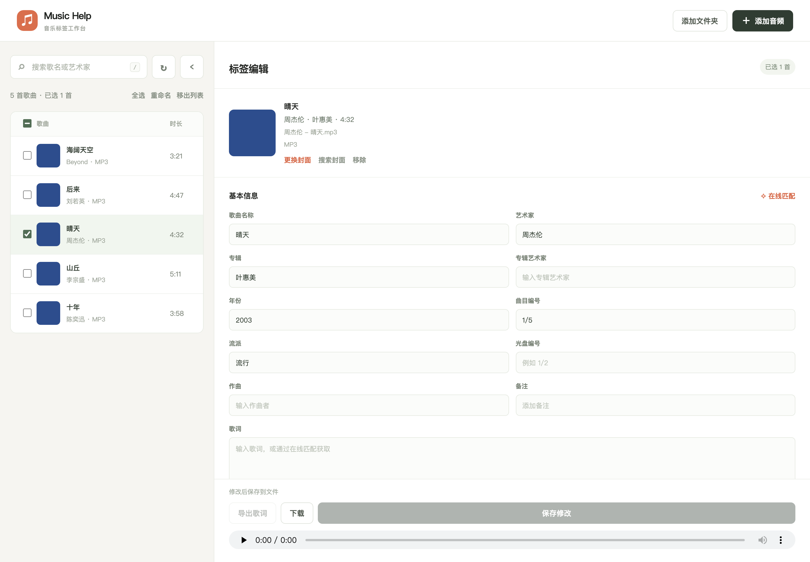
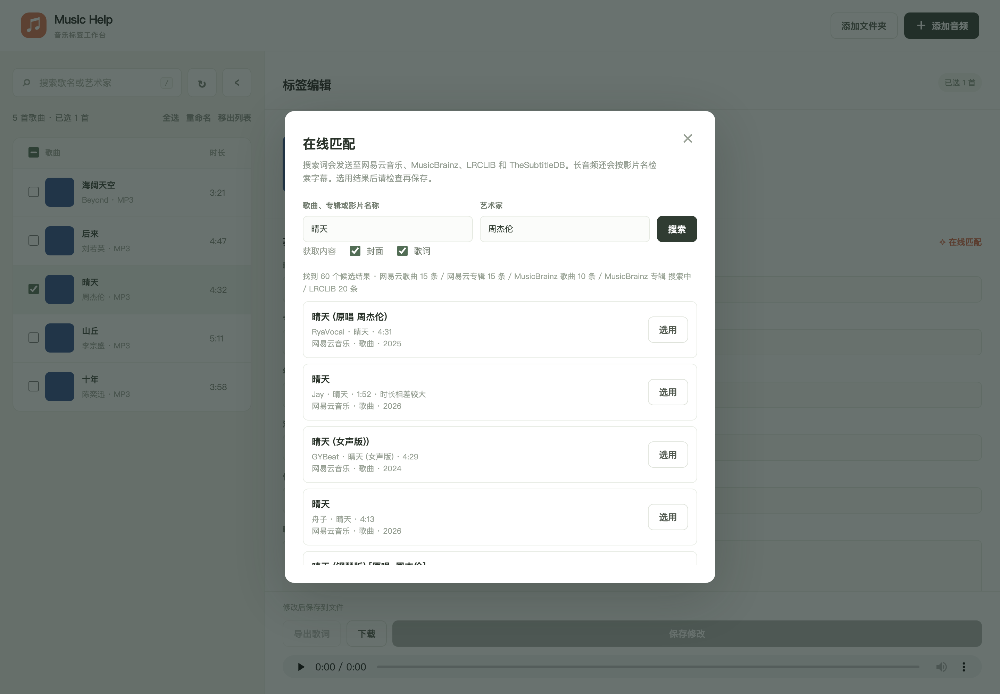
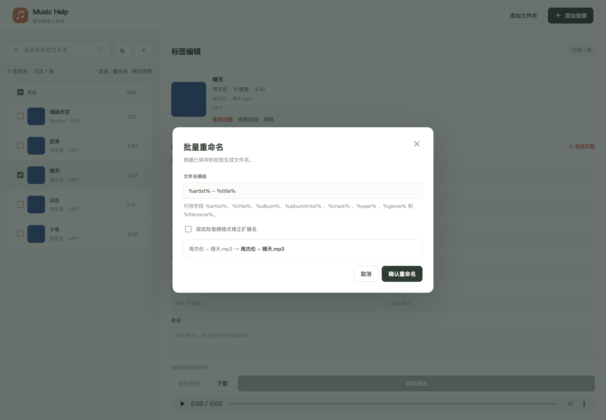

# Music Help

本地运行的音频标签管理网页。导入文件或扫描音乐目录后，可以编辑歌曲信息、封面和歌词，通过网易云音乐、MusicBrainz、Cover Art Archive、LRCLIB 和 TheSubtitleDB 查找在线资料，再按模板重命名或打包下载。

[](#环境要求)
[](#环境要求)
[](#环境要求)
[](LICENSE)
[](#验证)

Python 3.10+ · Flask 3.1 · 默认监听 `127.0.0.1:8765` · 数据留在本机 · MIT License

```bash
python3 -m venv .venv && source .venv/bin/activate
pip install -r requirements.txt
python app.py
```

打开 `http://127.0.0.1:8765`。

**为什么需要它**：桌面标签编辑器要装客户端，播放器又不读文件内嵌歌词；给一批老歌补齐艺术家、专辑、封面和歌词，往往要在好几个网站之间来回抄。这个工具把读取、编辑、在线检索、重命名和导出放在同一个页面，音频文件不离开本机，只有搜索用的名称会发到公开服务。



## 目录

- [功能](#功能)
- [界面预览](#界面预览)
- [环境要求](#环境要求)
- [安装](#安装)
- [使用](#使用)
- [支持的格式](#支持的格式)
- [在线数据来源](#在线数据来源)
- [实现说明](#实现说明)
- [安全](#安全)
- [限制](#限制)
- [验证](#验证)
- [开发](#开发)
- [English](#english)

## 功能

- **两种来源**：上传单个文件、上传整个文件夹，或让服务递归扫描 `--music-dir` 指定的服务器目录。两者可以同时使用，列表里混合显示。
- **按内容识别格式**：用 mutagen 打开文件判断真实容器，不依赖扩展名。扩展名与实际格式不一致时，列表和编辑区会标出来。
- **字段完整**：标题、艺术家、专辑、专辑艺术家、年份、音轨号、碟号、流派、作曲者、备注、歌词和封面，分别映射到 ID3、MP4 atom、Vorbis Comment、APEv2、ASF 和 RIFF INFO 六套标签体系。
- **单曲与批量编辑**：选中单曲编辑全部字段，或多选后批量修改。保存时只写入改动过的字段，未改动的标签、歌词和封面保持原样。
- **在线匹配**：一次搜索并发查询网易云音乐、MusicBrainz、LRCLIB，从候选里选择歌曲或专辑，再单独勾选要填入的封面和歌词。
- **字幕转歌词**：长音频可以按影片名检索 TheSubtitleDB 字幕，解析 SRT、VTT、ASS、SSA 后转成带时间轴的 LRC。
- **版本校验**：读取时记录设备号、inode、大小和纳秒级修改时间。文件在编辑期间被其他程序改动，保存和重命名会停止并提示重新读取。
- **写入不破坏原文件**：先在同一目录创建临时副本，标签写入副本后再替换原文件；音频数据和未修改的标签帧都保留。
- **重命名与下载**：用 `%artist% - %title%` 这类模板批量改名，可选按实际格式修正扩展名；单首直接下载，多首打包为 ZIP。
- **歌词导出**：把歌词写成与音频同名的 `.lrc`，供 QQ 音乐、网易云音乐等不读取内嵌歌词的播放器关联本地歌词。

## 界面预览

以下截图使用示意曲库，专辑封面为测试图。在线匹配的结果来自真实检索，实际显示的文件、路径和候选以本机为准。点击图片可以查看原图。

| 在线匹配 | 批量重命名 |
| --- | --- |
| [](https://raw.githubusercontent.com/zdkcomeon/music-help/main/docs/screenshots/02-match-dialog.png) | [](https://raw.githubusercontent.com/zdkcomeon/music-help/main/docs/screenshots/03-rename-dialog.png) |

## 环境要求

- Python 3.10 及以上，开发环境使用 3.13。
- Flask `3.1+`、mutagen `1.48.1+`、waitress `3.0+`、truststore `0.10+`，见 [requirements.txt](requirements.txt)。
- 在线匹配和字幕检索需要服务所在机器能访问对应站点。HTTPS 证书校验使用 truststore，直接读取系统信任库，不需要额外配置 CA。
- FFmpeg 只用于多格式回归测试，运行服务本身不需要。

## 安装

```bash
python3 -m venv .venv
source .venv/bin/activate
pip install -r requirements.txt
```

Windows 下用 `.venv\Scripts\activate` 激活虚拟环境。

如果音乐文件已经在运行服务的电脑上，可以指定音乐目录：

```bash
python app.py --music-dir /path/to/music
python app.py --music-dir /path/to/music --host 0.0.0.0 --port 9000
```

三个参数也可以分别用环境变量 `MUSIC_DIR`、`HOST`、`PORT` 提供。目录不存在时启动会直接报错退出。服务使用 waitress，默认 8 个工作线程，单次请求体上限 2 GB。

## 使用

### 导入歌曲

首次打开时页面只显示导入入口，添加音频后进入歌曲列表和标签编辑。

- 点击 `添加音频` 或直接把文件拖进窗口。单次上传上限 2 GB。
- 点击 `添加文件夹` 选择整个目录。
- 配置了 `--music-dir` 时，服务器目录会出现在列表中，可以刷新重新读取。

上传的文件保存在服务的临时目录中，服务重启后会被清理，需要保留的先下载。格式识别失败的文件会单独提示，不影响其他文件。

### 编辑标签

- 选中单曲编辑基础信息、歌词和封面；点击多行或勾选复选框可以批量修改，批量保存只应用改动过的字段。
- 在线匹配和 `搜索封面` 只对单首歌曲启用，多选时这两个按钮不可用。
- 封面支持 JPEG 和 PNG，最大 10 MB。可以本地导入、从在线匹配获取，或移除。
- 年份按 `YYYY`、`YYYY-MM`、`YYYY-MM-DD` 校验，音轨号和碟号支持 `3/12` 形式。
- 歌曲列表可以收起，把编辑区放宽；收起状态保存在浏览器本地。
- 列表顶部可以按歌名或艺术家过滤，`/` 直接聚焦搜索框。

### 在线匹配

点击 `在线匹配`，输入歌曲、专辑或艺术家名称后搜索：

- 候选结果同时来自网易云音乐歌曲、网易云音乐专辑、MusicBrainz 录音和 MusicBrainz 发行组，也包含 LRCLIB 的歌词条目。
- 弹窗里可以勾选要获取的部分，默认同时获取封面和歌词，也可以只取其中一个。
- `搜索封面` 用同一套检索单独找封面，`更换封面` 从本地导入图片，`移除` 清空当前封面。
- 获取到的资料先填入编辑区，检查后点击保存才写入文件。

搜索只把输入的名称发送到上述服务，不上传音频。名称每项最多 300 个字符。

### 字幕转歌词

时长达到 30 分钟的音频会优先展示专辑候选，并额外按影片名检索 TheSubtitleDB：

- 候选结果会标出语言、时长和字幕条数，优先选择时长与音频一致的版本。
- 字幕检索要用影片原名，译名不一定能匹配。
- 字幕文本可能包含对白、报幕和翻译。字幕带有统一样式时，程序优先保留带样式的歌词行；其余情况保留全部文本。
- 这类长音频选用歌曲或专辑结果时不会自动填入单曲歌词。选用字幕后请人工检查再保存。

### 试听、重命名和下载

- 选中歌曲后可以试听，播放采用区间请求，浏览器支持的格式取决于浏览器本身。
- `重命名` 用文件名模板批量改名，默认模板 `%artist% - %title%`，可用字段是全部标签字段加上 `%filename%`。可以同时勾选按检测结果修正扩展名。
- 重命名遇到同名文件会跳过该文件，并给出提示；不会覆盖已有文件。
- 下载单首时直接返回原文件，多首会打包为 ZIP，重名条目自动追加序号。

### 导出歌词

编辑区底部的 `导出歌词` 会把歌词写成与音频同名的 `.lrc`。QQ 音乐、网易云音乐等播放器不读取文件内嵌歌词，把 `.lrc` 和音频放在同一目录，再在播放器的歌词面板里选择关联本地歌词即可。

### 快捷键

| 快捷键 | 作用 |
| --- | --- |
| `/` | 聚焦歌曲搜索框 |
| `Cmd/Ctrl + S` | 保存当前修改 |
| 拖拽文件到窗口 | 上传 |

## 支持的格式

扩展名只是建议值，实际格式按文件内容判断。

| 格式 | 扩展名 | 标签体系 | 回归测试 |
| --- | --- | --- | --- |
| MP3 | `.mp3` | ID3v2.3 / v2.4 | 有 |
| AAC 裸流 | `.aac` `.adts` `.adif` | ID3 | 有 |
| MP4 音频 | `.m4a` `.m4b` `.mp4` `.m4p` | MP4 atom | 有 |
| FLAC | `.flac` | Vorbis Comment + Picture | 有 |
| Ogg Vorbis | `.ogg` `.oga` | Vorbis Comment | 有 |
| Opus | `.opus` `.ogg` | Vorbis Comment | 有 |
| WAV | `.wav` `.wave` | RIFF INFO / ID3 | 有 |
| AIFF | `.aiff` `.aif` `.aifc` | 文本块 / ID3 | 有 |
| WMA | `.wma` `.asf` | ASF | 有 |
| WavPack | `.wv` | APEv2 | 有 |
| True Audio | `.tta` | ID3 | 有 |
| APE | `.ape` | APEv2 | 无 |
| Musepack | `.mpc` `.mp+` `.mpp` | APEv2 | 无 |
| TAK | `.tak` | APEv2 | 无 |
| OptimFROG | `.ofr` `.ofs` | APEv2 | 无 |
| Ogg FLAC | `.oga` `.ogg` | Vorbis Comment + Picture | 无 |
| Ogg Speex | `.spx` `.ogg` | Vorbis Comment | 无 |

ID3v2.3 标签会继续保存为 v2.3，ID3v2.2 标签会转换为 v2.4。AAC 裸流使用 ID3 标签，不同播放器对这些标签的支持可能不同。带 ID3 前缀的 FLAC 会同时维护 ID3 和 Vorbis Comment 两套标签。

## 在线数据来源

| 来源 | 接口 | 用途 |
| --- | --- | --- |
| 网易云音乐 | `music.163.com/api` | 歌曲和专辑搜索、歌词、封面 |
| MusicBrainz | `musicbrainz.org/ws/2` | 录音和发行组搜索 |
| Cover Art Archive | `coverartarchive.org` | 按发行 ID 取封面 |
| LRCLIB | `lrclib.net/api` | 带时间轴的歌词 |
| TheSubtitleDB | `api.thesubtitledb.org` | 影片字幕 |

MusicBrainz 请求按 1.1 秒间隔串行排队，符合它的速率要求；遇到 502、503、504 或网络错误会重试一次。其余来源并发查询，单个来源失败不影响其他结果，失败原因放在返回的 `warnings` 里。

## 实现说明

### 数据流

1. 浏览器加载单页界面，模板注入本次启动生成的 CSRF token 和支持的扩展名列表。
2. 上传或扫描时，服务用 mutagen 打开文件，读取标签、封面、时长和码率，返回统一的曲目 JSON。
3. 保存时服务先核对文件版本，把原文件复制成同目录的 `.music-help-*` 临时副本，写入标签后用 `os.replace` 替换原文件。
4. 在线匹配时服务并发请求各来源，合并成候选列表；选中候选后再单独请求封面和歌词。
5. 字幕按 SRT、VTT、ASS 或 SSA 解析成时间轴，清洗后输出 LRC。

### HTTP 接口

| 方法 | 路径 | 用途 |
| --- | --- | --- |
| `GET` | `/` | 渲染单页界面 |
| `GET` | `/api/library` | 递归扫描服务器音乐目录并返回曲目 |
| `POST` | `/api/files` | 上传一个音频文件 |
| `GET` | `/api/files/<id>` | 重新读取单曲标签 |
| `DELETE` | `/api/files/<id>` | 从列表移除，上传文件同时删除临时副本 |
| `POST` | `/api/tags` | 保存标签、歌词和封面 |
| `POST` | `/api/rename` | 按模板重命名 |
| `GET` | `/api/files/<id>/cover` | 读取封面 |
| `GET` | `/api/files/<id>/audio` | 试听，支持区间请求 |
| `GET` | `/api/files/<id>/lyrics` | 导出 `.lrc` |
| `GET` | `/api/download` | 下载单个文件或打包 ZIP |
| `GET` | `/api/online/search` | 在线搜索候选 |
| `POST` | `/api/online/details` | 获取选中候选的封面和歌词 |

### 写入与校验

- 保存前对比设备号、inode、大小和 `st_mtime_ns`，与读取时不一致就拒绝写入。
- 标签写入只修改传入的字段，其余帧、音频流和其他元数据原样保留。
- 单个标签字段上限 1 MB，封面上限 10 MB，整体请求体上限 2 GB。
- 重命名优先用硬链接加删除原文件的方式完成，文件系统不支持时退化为 `os.replace`。
- 服务器目录中的文件直接改名；上传文件保存后，下载名会按艺术家和标题重新生成，并按实际格式修正扩展名，已经手动重命名过的上传文件保持手动名称。

## 安全

- 默认只监听 `127.0.0.1`，需要局域网访问时显式指定 `--host`。
- 每次启动生成随机 CSRF token，所有 `POST`、`PUT`、`PATCH`、`DELETE` 请求必须带上 `X-Music-Help-Token` 头。
- 文件路径限制在音乐目录或本次会话的临时上传目录内，符号链接一律跳过。
- 上传文件名会去掉路径分隔符、控制字符和 Windows 保留名。
- 网易云音乐的封面地址限定在 `music.126.net` 并强制 https，重定向到其他主机会被拒绝；Cover Art Archive 的封面按发行 ID 从固定路径获取。
- 日志对 token、authorization、cookie、签名等敏感键值脱敏，URL 只记录协议、主机和路径，不记录查询参数和凭据。
- 在线请求及其响应会记录在服务日志中，便于排查，但音频文件不上传。

## 限制

- 在线匹配只按名称检索，不识别音频内容；多首歌曲拼接的文件需要手动选择专辑等候选。
- 结果取决于公开资料的覆盖范围和服务可用性，无法保证每首歌都有候选、封面或歌词。
- 第三方字幕的覆盖范围和版本一致性无法保证，译文和原名不一定匹配。
- 上传文件放在临时目录，服务重启后清理，需要保留请先下载。
- 内嵌歌词能否显示取决于播放器，QQ 音乐、网易云音乐不读取内嵌歌词。
- 没有用户系统，不适合直接暴露到公网。
- 重命名遇到同名文件会跳过该文件，不做覆盖。
- AAC 裸流的 ID3 标签在部分播放器上可能不生效。

## 验证

```bash
python -m unittest discover -s tests -v
```

多格式回归测试使用系统 FFmpeg，或 Python 环境中的 `imageio-ffmpeg` 生成音频样本。缺少 FFmpeg 时，这部分测试会跳过。测试覆盖标签读写与音频数据不变性、批量保存冲突、重命名不覆盖、上传下载流程、歌词导出、在线搜索结果解析、字幕转 LRC 和接口参数校验。

## 开发

```bash
python3 -m venv .venv
source .venv/bin/activate
pip install -r requirements.txt
python app.py                      # 启动服务
python -m unittest discover -s tests -v
```

后端是 Flask 加 waitress，前端是没有构建步骤的原生 JavaScript 和 CSS，改完刷新页面即可。

### 目录

```text
app.py                          Flask 应用、路由、会话内曲目表和启动参数
music_help/tags.py              格式识别、标签读写、封面处理
music_help/online.py            在线搜索、详情获取、请求日志脱敏
music_help/subtitles.py         字幕解析与 LRC 生成
templates/index.html            单页模板
static/app.js                   页面交互、列表渲染、编辑与在线匹配
static/style.css                页面样式
tests/                          unittest 测试
docs/screenshots/               README 截图
requirements.txt                运行依赖
LICENSE                         MIT 许可证
```

## English

`Music Help` is a locally hosted web page for editing audio tags. It imports audio files or scans a music directory, then lets you edit title, artist, album, album artist, year, track, disc, genre, composer, comment, lyrics and cover art in one place.

- Reads and writes ID3, MP4 atoms, Vorbis Comment, APEv2, ASF and RIFF INFO across 17 container types, detecting the real format from file content instead of the extension.
- Looks up metadata, artwork and lyrics on NetEase Cloud Music, MusicBrainz, Cover Art Archive, LRCLIB and TheSubtitleDB. Only the search names leave the machine; audio files never do.
- Converts SRT, VTT, ASS and SSA subtitles of long audio into timed LRC lyrics.
- Detects external edits through device, inode, size and nanosecond mtime checks, and saves through a temporary copy in the same directory, so a failed write cannot damage the original file.
- Renames by template with a live preview, downloads single files or a ZIP, and exports lyrics as a sidecar `.lrc`.

```bash
python3 -m venv .venv && source .venv/bin/activate
pip install -r requirements.txt
python app.py
```

Open `http://127.0.0.1:8765`. Requires Python 3.10 or newer. Everything runs locally except online matching.

## 许可证

MIT License，见 [LICENSE](LICENSE)。
